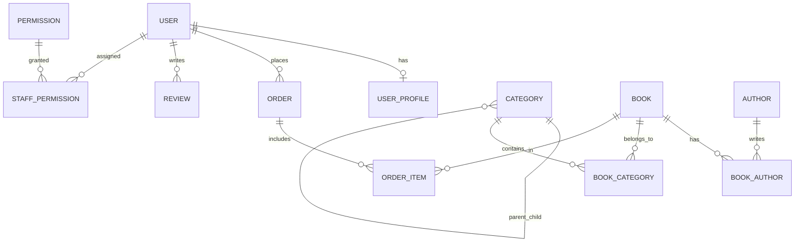

# TỔ SÁCH — TÀI LIỆU TOÀN DIỆN ĐỒ ÁN LIÊN NGÀNH
> **Khẩu hiệu:** *"Sách về tổ, tri thức bay xa"*  
> **Chuyên ngành:** Công nghệ Thông tin  
> **Thời gian bảo vệ dự kiến:** Tháng 10/2026  
> **Nhóm tác giả thực hiện:**  
> * **Nguyễn Đăng Hanh** (Hanh-Dang — hnhngyndng@gmail.com)  
> * **Nguyễn Mạnh Hòa** (ManhHoa2405 — manhhoa02042005@gmail.com)

---

## 1. Tổng Quan Dự Án & Định Vị Mô Hình

### 1.1 Mục tiêu đề tài
Xây dựng một hệ sinh thái thương mại điện tử chuyên biệt cho ngành sách, giải quyết bài toán trải nghiệm mua sắm trực tuyến chuyên sâu, tinh gọn, tiện dụng cho độc giả và cung cấp công cụ vận hành trực quan, chuẩn chỉ cho nhà quản trị sách.

### 1.2 Mô hình kinh doanh: B2C Thuần Túy (Business-to-Consumer)
* **Bản chất:** Một đơn vị kinh doanh trung tâm (Tổ Sách) trực tiếp nhập, quản lý catalog và phân phối sách tới tay độc giả.
* **Lý do KHÔNG chọn Marketplace (C2C) hay Cho thuê sách:**
  1. **Đảm bảo chất lượng sách:** Khác với sàn C2C dễ gặp sách lậu, sách giả, mô hình B2C giúp nhà sách kiểm soát 100% bản quyền, nguồn gốc NXB chính thống.
  2. **Trải nghiệm khách hàng đồng nhất:** Quản lý tập trung từ khâu đóng gói, vận chuyển đến chăm sóc khách hàng.
  3. **Phù hợp với phạm vi đồ án:** Tập trung làm sâu và hoàn thiện trọn vẹn quy trình bán hàng, thanh toán, quản lý kho và phân quyền nhân viên thay vì dàn trải sang các module phức tạp của sàn đa người bán.

---

## 2. Kiến Trúc Kỹ Thuật (Tech Stack) & Cơ Sở Lựa Chọn

| Thành phần | Công nghệ | Lý do lựa chọn & Điểm mạnh bảo vệ đồ án |
|---|---|---|
| **Fullstack Framework** | **Next.js 15 (App Router)** | Hỗ trợ Server Components giúp tải trang cực nhanh, tối ưu SEO vượt trội cho sản phẩm sách, file-based routing trực quan, tích hợp sẵn API routes và Middleware. |
| **Ngôn ngữ** | **TypeScript** | Định kiểu tĩnh (Static Typing) chặt chẽ, bắt lỗi ngay trong quá trình biên dịch (Compile-time), mã nguồn dễ bảo trì và mở rộng. |
| **Styling** | **Tailwind CSS v4** | Hệ thống Utility-first CSS hiện đại, tối ưu dung lượng bundle, tái sử dụng Design System (`#0B1F3A` - Xanh hải quân, `#F5A623` - Vàng nghệ). |
| **Typography (Font chữ)** | **Plus Jakarta Sans** | Kiểu chữ hình học hiện đại, hỗ trợ chuẩn xác toàn bộ bộ ký tự và dấu tiếng Việt (Vietnam subsets), tối ưu tối đa cho ấn phẩm sách và văn bản dài. |
| **Nhận diện Thương hiệu** | **Logo Tổ Sách (`UI/logo - icon`)** | Biểu trưng độc quyền Tổ Sách: Tổ chim che chở, Đôi cánh tri thức và Hạt mầm tri thức tinh khôi trên nền khối bo tròn squircle `#0B1F3A`. |
| **ORM** | **Prisma 6** | Object-Relational Mapping kiểu an toàn (Type-safe), tự động sinh migration, hỗ trợ quan hệ bảng phức tạp, chống triệt để tấn công SQL Injection. |
| **Database** | **PostgreSQL (Supabase Cloud)** | Hệ quản trị cơ sở dữ liệu quan hệ mạnh mẽ, chuẩn ACID, hỗ trợ Transaction, Connection Pooling (PgBouncer) và Full-Text Search. |
| **Xác thực (Auth)** | **Custom JWT + HttpOnly Cookie + Bcrypt** | Cơ chế xác thực phi trạng thái (Stateless), bảo mật cao chống XSS (nhờ HttpOnly cookie) và CSRF (nhờ SameSite lax), mật khẩu được băm bằng thuật toán Bcrypt. |
| **Phân quyền (RBAC)** | **Next.js Proxy / Middleware** | Kiểm tra quyền truy cập route ngay tại tầng rìa mạng (Edge/Proxy), ngăn chặn truy cập trái phép vào trang Admin trước khi trang render. |

---

## 3. Thiết Kế Cơ Sở Dữ Liệu & Phân Quyền (RBAC)

Hệ thống gồm **14 bảng quan hệ** chặt chẽ trong file [`prisma/schema.prisma`](file:///e:/to-sach-studio/prisma/schema.prisma):



### 3.1 Mô hình Phân quyền Người dùng (RBAC)
Proposal quy định chuẩn **3 vai trò**:
1. **`USER` (Khách hàng):** Tìm kiếm sách, xem chi tiết, đánh giá, quản lý giỏ hàng, đặt hàng, theo dõi lịch sử đơn hàng, cập nhật sổ địa chỉ.
2. **`STAFF` (Nhân viên vận hành):** Phân quyền động qua bảng `staff_permissions`. Một nhân viên có thể được cấp 1 hoặc nhiều quyền:
   - `MANAGE_BOOKS`: Thêm/sửa/xóa sách, quản lý tồn kho và giá bìa.
   - `MANAGE_ORDERS`: Tiếp nhận, xác nhận đóng gói và cập nhật vận chuyển đơn hàng.
   - `MANAGE_CATEGORIES`: Quản lý cây phân cấp danh mục 3 tầng.
   - `MANAGE_REVIEWS`: Kiểm duyệt bình luận, đánh giá của khách hàng.
   - `VIEW_AUDIT_LOG`: Theo dõi nhật ký kiểm toán.
3. **`SUPER_ADMIN` (Quản trị viên tối cao):** Toàn quyền hệ thống, quản lý tài khoản nhân viên, cấp phát quyền hạn, xem doanh thu và thống kê.

### 3.2 Cơ Chế Quản Lý Giỏ Hàng Cách Ly & Hợp Nhất Thông Minh (Smart Cart Merge)
Hệ thống thương mại điện tử Tổ Sách áp dụng kiến trúc quản lý giỏ hàng theo chuẩn quốc tế (Shopee, Amazon), giải quyết triệt để bài toán bảo mật riêng tư và trải nghiệm người dùng liền mạch:
1. **Phân vùng giỏ hàng độc lập (Storage Partitioning):**
   - Khách vãng lai: Lưu vào key `tosach_guest_cart`.
   - Thành viên đã đăng nhập: Lưu vào key độc lập gắn chặt theo ID người dùng: `tosach_user_cart_<userId>`.
2. **Kịch bản 1 — Đăng ký tài khoản mới:**
   - Khách vãng lai nhặt sách vào giỏ $\rightarrow$ bấm Đặt hàng $\rightarrow$ sang `/auth` Đăng ký tài khoản mới.
   - Tài khoản mới tạo lập tức kế thừa 100% danh sách sách từ `tosach_guest_cart` sang `tosach_user_cart_<newUserId>`. Xóa sạch giỏ guest để giải phóng bộ nhớ.
3. **Kịch bản 2 — Đăng nhập tài khoản cũ (Smart Merge):**
   - Khách vãng lai nhặt sách mới bên ngoài $\rightarrow$ bấm Đăng nhập tài khoản đã có lịch sử giỏ hàng trước đó.
   - Hệ thống tự động **hợp nhất thông minh**: Nạp lịch sử giỏ hàng của tài khoản cũ, gộp thêm các cuốn sách vừa nhặt ngoài luồng (nếu trùng sách thì cộng dồn số lượng tối đa theo tồn kho `stockQty`, nếu sách mới thì thêm vào). Xóa sạch giỏ guest.
4. **Kịch bản 3 — Đăng xuất (Logout) & Bảo mật dữ liệu:**
   - Khi người dùng bấm Đăng xuất: Toàn bộ giỏ hàng của user được lưu lại an toàn vào `tosach_user_cart_<userId>`, giỏ hàng trên màn hình lập tức được reset về rỗng (`[]`).
   - Đảm bảo nếu người dùng khác đăng nhập vào cùng máy tính/trình duyệt, họ sẽ **hoàn toàn không bao giờ** nhìn thấy sản phẩm trong giỏ của người trước.

---

## 4. Nhật Ký Tiến Độ Dự Án (Project Progress)

```
[====== GIAI ĐOẠN 1: NỀN TẢNG (TUẦN 1) ======] ---> HOÀN THÀNH 100% (07/09 — 13/09/2026)
[=== GIAI ĐOẠN 2: FRONTEND & AUTH (TUẦN 2) ==] ---> HOÀN THÀNH 100% (14/09 — 20/09/2026) [MỐC BÁO CÁO 1]
[=== GIAI ĐOẠN 3: CATALOG & DETAILS (TUẦN 3) =] ---> HOÀN THÀNH 100% (21/09 — 27/09/2026)
[   GIAI ĐOẠN 4: CART & CHECKOUT (TUẦN 4)    ] ---> DỰ KIẾN (28/09 — 04/10/2026) [MỐC BÁO CÁO 2]
[   GIAI ĐOẠN 5: ADMIN & RBAC (TUẦN 5-6)     ] ---> DỰ KIẾN (05/10 — 18/10/2026) [MỐC BÁO CÁO 3]
[   GIAI ĐOẠN 6: TEST, DEPLOY & BẢO VỆ (7-8) ] ---> DỰ KIẾN (19/10 — 30/10/2026) [MỐC BÁO CÁO 4]
```

### 4.1 Giai Đoạn 1 (Tuần 1: 07/09 — 13/09/2026): Nền Tảng Kiến Trúc & Thiết Kế Database
*Trạng thái: **ĐÃ HOÀN THÀNH 100%***

* [x] **Xác định định vị mô hình kinh doanh:** Lựa chọn mô hình B2C (Doanh nghiệp tới Khách hàng) thuần túy; giải trình lý do không chọn sàn thương mại C2C hay mô hình thuê sách.
* [x] **Phân tích yêu cầu & Use Cases:** Xây dựng sơ đồ Use Case cho 3 nhóm đối tượng: Khách hàng (`USER`), Nhân viên vận hành (`STAFF`), Quản trị viên tối cao (`SUPER_ADMIN`).
* [x] **Thiết kế Cơ sở Dữ liệu quan hệ (ERD):** Thiết kế hoàn chỉnh 14 bảng quan hệ với ràng buộc toàn vẹn, khoá ngoại, Index và Enum trạng thái (`Role`, `OrderStatus`, `PaymentStatus`, `PaymentMethod`, `BookFormat`).
* [x] **Thiết kế phân quyền động (Dynamic RBAC):** Xây dựng bảng `permissions` và `staff_permissions` cho phép cấp quyền chi tiết từng chức năng cho nhân viên.
* [x] **Dọn dẹp mã nguồn cũ:** Chuyển đổi toàn bộ code prototype Express/Vite cũ vào thư mục `legacy/` làm tư liệu tham khảo UI/Logic.

---

### 4.2 Giai Đoạn 2 (Tuần 2: 14/09 — 20/09/2026): Frontend, Auth & Chuẩn Hóa Thương Hiệu
*Trạng thái: **ĐÃ HOÀN THÀNH 100% (Đạt Mốc Báo Cáo 1)***

* [x] **Dọn dẹp kiến trúc:** Chuyển toàn bộ code Express/Vite prototype vào `legacy/` làm tư liệu tham khảo UI/Logic.
* [x] **Khởi tạo Framework chuẩn:** Thiết lập dự án Next.js 15 (App Router, TypeScript, Tailwind CSS v4) tại thư mục gốc.
* [x] **Thiết kế Database chuẩn Proposal:** Xây dựng `prisma/schema.prisma` với đầy đủ 14 bảng quan hệ, Enum phân quyền 3 vai trò (`USER`, `STAFF`, `SUPER_ADMIN`).
* [x] **Kết nối & Đẩy bảng lên Supabase Cloud:** Chạy `npx prisma db push` thành công 100% lên PostgreSQL Supabase Singapore.
* [x] **Nạp dữ liệu mẫu ban đầu (Seed Data):** Viết và chạy `prisma/seed.ts` nạp thành công 6 quyền hạn, 4 tài khoản mẫu (`admin@tosach.vn`, `staff.kho@tosach.vn`, `staff.order@tosach.vn`, `customer@gmail.com`), 8 đầu sách, cây danh mục 3 tầng, tác giả và đơn hàng mẫu.
* [x] **Hệ thống Xác thực (Auth Engine):** Viết `src/lib/auth.ts`, các API route `/api/auth/login`, `/api/auth/register`, `/api/auth/logout`, `/api/auth/me` với JWT mã hóa `jose` và HttpOnly Cookie.
* [x] **Khung Layout & Header Chuẩn Thương Hiệu Figma (`src/components/layout/CustomerHeader.tsx`):**
  - Căn chỉnh bố cục chuẩn: Cột trái (Logo thương hiệu Tổ Sách), Cột giữa (Trang chủ, Danh mục Mega Menu, Tất cả sách), Cột phải (Tìm kiếm nhanh, Yêu thích, Giỏ hàng, Khung tài khoản).
  - Triệt tiêu hoàn toàn xô lệch layout (Zero Cumulative Layout Shift - CLS) khi đăng nhập / đăng xuất bằng cách cố định khung tài khoản `w-[125px] sm:w-[145px]`.
  - Thanh thông báo Top Bar chạy liên tục từ TRÁI SANG PHẢI (Left-to-Right marquee) tốc độ 55s mượt mà, loại bỏ triệt để voucher giảm giá để tuân thủ 100% mô hình B2C chiết khấu trực tiếp trên giá bìa.
  - Tích hợp Mega Menu xổ xuống xem nhanh 4 ngành hàng với đường dẫn trực tiếp sang trang Catalog.
* [x] **Typography Chuẩn Mực Xuất Bản — Plus Jakarta Sans:**
  - Thay thế font Geist và Arial fallback bằng `Plus Jakarta Sans` hỗ trợ trọn vẹn dải ký tự và thanh dấu tiếng Việt (`subsets: ['vietnamese', 'latin']`, `weights: 400-800`).
  - Cấu hình đồng bộ trong `src/app/layout.tsx`, `src/app/globals.css`, cập nhật `README.md` và tài liệu kiến trúc.
* [x] **Bộ Nhận Diện Thương Hiệu & Logo Chính Thức:**
  - Sử dụng vector chuẩn từ `UI/logo - icon/Group.svg` tạo component `ToSachLogo.tsx` (Tổ chim che chở, Đôi cánh tri thức và Hạt mầm tri thức trên squircle `#0B1F3A`).
  - Thay thế toàn bộ icon `BookOpen` cũ tại CustomerHeader, CustomerFooter, trang Auth, và xuất file `src/app/icon.svg` làm favicon tab trình duyệt.
* [x] **Làm Sạch Dữ Liệu Catalog — 100% Kết Nối Database Thật (`src/app/catalog`):**
  - Xóa bỏ hoàn toàn dữ liệu giả (Mock Books).
  - Kết nối trực tiếp Prisma ORM truy vấn đúng 8 tựa sách, hiển thị số lượng chính xác trong ngoặc đơn theo từng thể loại (Văn học: 3, Công nghệ: 2, Kinh tế: 1, Lịch sử: 1, Tâm lý: 1) và các Nhà xuất bản thật (NXB Trẻ, NXB Hội Nhà Văn, NXB Lao Động, NXB Tri Thức...).
* [x] **Hệ Thống Tủ Sách Yêu Thích Toàn Diện (Wishlist Engine):**
  - Xây dựng `WishlistContext.tsx`: Quản lý danh sách sách yêu thích, lưu trữ cục bộ `localStorage` phân vùng độc lập giữa khách vãng lai (`tosach_guest_wishlist`) và tài khoản đăng nhập (`tosach_user_wishlist_${userId}`).
  - Tự động hợp nhất (Smart Merge) khi đăng nhập: gộp các đầu sách khách vãng lai đã thích vào tài khoản đăng nhập mà không trùng lặp.
  - Tích hợp nút Trái tim tương tác realtime trên cả 2 component thẻ sách: `BookCard.tsx` (Trang chủ) và `CatalogBookCard.tsx` (Trang Catalog).
  - Huy hiệu số lượng sách yêu thích trên CustomerHeader (Desktop & Mobile Drawer) cập nhật tức thì.
  - Xây dựng Trang quản lý Sách Yêu Thích chuyên biệt tại `src/app/wishlist/page.tsx`: Cho phép xem danh sách, xóa từng cuốn, xóa tất cả, hoặc 1-Click "Chuyển Tất Cả Vào Giỏ Hàng", kèm giao diện Empty State thân thiện.
* [x] **Kiểm thử biên dịch & Type Safety:** Kiểm tra `npx tsc --noEmit` đạt 0 lỗi; kiểm tra các trang `/`, `/catalog`, `/wishlist`, `/auth` đều render HTTP 200 thành công.

---

### 4.3 Giai Đoạn 3 (Tuần 3: 21/09 — 27/09/2026): Bộ Lọc Catalog Đa Chiều & Trang Chi Tiết Sách
*Trạng thái: **ĐÃ HOÀN THÀNH 100%***

* **Hiện trạng tiến độ Tuần 3:**
  - Đã kết nối dữ liệu thật từ Supabase DB cho trang Catalog (`src/app/catalog/page.tsx`), Tủ sách yêu thích (`/wishlist`) và Chi tiết sách (`/book/[slug]`).
* **Các hạng mục đã hoàn thành trọn vẹn trong Tuần 3:**
  * [x] **Bước 1 — Nâng cấp Bộ Lọc & Tìm Kiếm Catalog (`src/app/catalog/page.tsx`):**
    - [x] Lọc sách theo Danh mục 3 cấp (L1 - L2 - L3) lấy từ Supabase DB.
    - [x] Lọc theo khoảng giá bìa và mức đánh giá sao.
    - [x] Sắp xếp: Bán chạy nhất (`soldCount`), Giá tăng dần, Giá giảm dần, Mới nhất.
    - [x] Tìm kiếm sách toàn văn theo từ khóa (tiêu đề, tác giả, mô tả) hỗ trợ tiếng Việt không dấu.
  * [x] **Bước 2 — Xây dựng Trang Chi Tiết Sách (`src/app/book/[slug]/page.tsx`):**
    - [x] Dynamic Route Server Component hiển thị chi tiết sách theo slug chuẩn SEO, tự động nạp JSON-LD Structured Data Schema (`schema.org/Product` & `BreadcrumbList`).
    - [x] Thư viện ảnh bìa sách nhiều góc nhìn (Cover + Extra Images), thumbnail tương tác mượt mà, huy hiệu "100% Chính Hãng", "Mới 100% Nguyên Seal".
    - [x] Bảng thông số xuất bản đầy đủ: NXB, số trang, kích thước, trọng lượng, định dạng bìa, ngôn ngữ, ISBN.
    - [x] Hiển thị danh sách đánh giá đã duyệt từ bảng `reviews`, biểu đồ phân bổ tỷ lệ sao và form gửi đánh giá kết nối API `/api/reviews`.
    - [x] Xử lý nút "Thêm vào giỏ" (`useCart`), "Mua ngay" (chuyển tiếp tới `/checkout`), và nút "Yêu thích" (`useWishlist`).
    - [x] Khối "Sách cùng thể loại có thể bạn thích" (Related Books) truy vấn trực tiếp từ PostgreSQL Supabase.

---

### 4.4 Lộ Trình Các Tuần Tiếp Theo (Kế Hoạch Đến Khi Bảo Vệ Đồ Án)

* **Tuần 4 (28/09 — 04/10/2026) [Mốc Báo Cáo 2]:**
  - Trang Giỏ hàng hoàn chỉnh (`/cart`): Tăng giảm số lượng, tính phí vận chuyển theo chính sách Freeship $\ge$ 150k.
  - Trang Đặt hàng & Thanh toán (`/checkout`): Sổ địa chỉ giao hàng, phương thức thanh toán COD & Chuyển khoản VietQR tự động sinh mã thanh toán, Database Transaction tạo `Order` và `OrderItem` trong Supabase.
* **Tuần 5 (05/10 — 11/10/2026):**
  - Phân hệ Quản trị (Admin Panel): Dashboard tổng quan doanh thu, biểu đồ tăng trưởng đơn hàng, module Quản lý kho sách (CRUD sách, cập nhật tồn kho, nhập hàng) và Quản lý danh mục.
* **Tuần 6 (12/10 — 18/10/2026) [Mốc Báo Cáo 3]:**
  - Phân hệ Admin: Quản lý và duyệt trạng thái đơn hàng (Chờ xác nhận $\rightarrow$ Đang đóng gói $\rightarrow$ Đang giao $\rightarrow$ Đã giao $\rightarrow$ Hủy đơn), Kiểm duyệt đánh giá sách, Quản trị phân quyền động RBAC cho nhân viên kho và nhân viên đơn hàng.
* **Tuần 7 (19/10 — 25/10/2026):**
  - Tích hợp Trợ lý AI tư vấn sách thông minh (Google Gemini API), tối ưu hóa SEO On-page toàn trang, Audit bảo mật và kiểm thử hiệu năng/giao diện đa thiết bị (Mobile/Tablet/Desktop).
* **Tuần 8 (26/10 — 30/10/2026) [Mốc Báo Cáo 4 - Nghiệm Thu Đồ Án]:**
  - Triển khai Production lên Vercel Cloud kết nối Supabase PostgreSQL thật, nghiệm thu UAT, hoàn thiện Quyển Báo cáo Thuyết minh A4 chuẩn định dạng khoa học và Slide thuyết trình bảo vệ đồ án.

---

## 5. Bí Kíp Trả Lời Câu Hỏi Hội Đồng Bảo Vệ (Q&A Defense Cheat Sheet)

### Câu 1: Tại sao em chuyển từ mô hình Express + Vite SPA sang Next.js App Router?
> **Trả lời:**  
> *"Dự án sách là một website thương mại điện tử phụ thuộc rất nhiều vào SEO và tốc độ tải trang lần đầu (First Contentful Paint). Vite SPA tải toàn bộ bundle JavaScript về trình duyệt rồi mới render (CSR), dẫn đến bot tìm kiếm (Google) khó lập chỉ mục chi tiết từng cuốn sách và người dùng bị màn hình trắng khi tải mạng chậm.  
> Em chọn Next.js App Router vì tính năng Server Components: toàn bộ dữ liệu sách được truy vấn trực tiếp từ PostgreSQL và render thành HTML tĩnh ngay trên server, tối ưu SEO 100%, bảo mật kết nối Database tuyệt đối và giảm dung lượng tải về máy khách."*

### Câu 2: Cơ chế xác thực (Authentication) của hệ thống hoạt động ra sao?
> **Trả lời:**  
> *"Hệ thống sử dụng Custom JWT kết hợp với HttpOnly Cookie. Khi người dùng đăng nhập, backend kiểm tra mật khẩu bằng thuật toán băm Bcrypt. Nếu đúng, server tạo một mã JSON Web Token (JWT) được ký số bảo mật bằng thư viện `jose` (thuật toán HS256), chứa thông tin định danh và vai trò của user, sau đó gán vào Cookie với cờ `HttpOnly` và `SameSite=Lax`.  
> Cách này vượt trội hơn lưu JWT trong LocalStorage vì ngăn chặn hoàn toàn nguy cơ bị hacker đánh cắp token qua các cuộc tấn công XSS (Cross-Site Scripting)."*

### Câu 3: Làm thế nào để phân quyền nhân viên (RBAC) mà không bị lộ quyền?
> **Trả lời:**  
> *"Hệ thống sử dụng bảo vệ 2 lớp:  
> 1. Lớp ngoài: Next.js Proxy/Middleware giải mã token ngay khi request tới server, lập tức chặn và chuyển hướng nếu vai trò không phải `STAFF` hoặc `SUPER_ADMIN`.  
> 2. Lớp trong: Tại Database, em thiết kế bảng `permissions` và bảng quan hệ `staff_permissions`. Mỗi khi nhân viên thực hiện một tác vụ quản trị (như xóa sách hoặc sửa đơn), server kiểm tra chính xác quyền trong cơ sở dữ liệu trước khi thực thi truy vấn."*

---

## 6. Quy Chuẩn Xây Dựng Giao Diện (UI Implementation Rules)

Để đảm bảo dự án bám sát 100% Proposal B2C và không bị nhầm lẫn giữa mã nguồn thương mại thật với các công cụ kiểm thử, toàn bộ quá trình migrate từ `UI/` và `legacy/` phải tuân thủ nghiêm ngặt bảng phân định sau:

### 6.1 Các thành phần BỎ HOÀN TOÀN (Không code, không tạo route):
* ❌ **Thẻ Banner Kêu gọi Seller / Trở thành người bán:** Mang bản chất marketplace C2C.
* ❌ **Vừa Đăng Bán (Realtime Feed):** Tính năng người dùng cá nhân bán lại sách cũ.
* ❌ **Request Rare Book Banner:** Tính năng tìm sách hiếm từ cộng đồng C2C.
* ❌ **Ô nhập Voucher / Quản lý Voucher:** Proposal B2C tập trung bán trực tiếp, đã lược bỏ hệ thống voucher phức tạp.
* ❌ **Floating AI Chatbot:** Tránh phân tán phạm vi chức năng bắt buộc của đồ án.

### 6.2 Giao diện Thực Tế của Hệ Thống (Production UI):
Toàn bộ mã nguồn sẽ bám sát thiết kế trong `UI/` và tái sử dụng JSX/Tailwind đã dựng sẵn trong `legacy/src/`:
1. **Header & Navigation B2C:** Logo thương hiệu Tổ Sách, ô tìm kiếm sách trực quan, nút Giỏ hàng kèm số lượng badge, Menu Tài khoản (Đăng nhập / Hồ sơ / Đơn mua).
2. **Trang Chủ (`/`):** Hero Banner giới thiệu Tổ Sách, Thống kê nhanh (Micro Stats), Sách Nổi Bật (dựa trên top bán chạy từ DB), Giờ Vàng Giá Tốt (Flash Sale), Mới Lên Kệ, Cây thể loại chính, Footer thương hiệu B2C.
3. **Trang Danh Mục & Tìm Kiếm (`/catalog`):** Bộ lọc danh mục 3 cấp (L1 - L2 - L3), lọc khoảng giá, lọc đánh giá sao, sắp xếp (Bán chạy, Giá tăng/giảm), phân trang hoặc infinite scroll.
4. **Trang Chi Tiết Sách (`/book/[slug]`):** Thư viện ảnh bìa, thông tin xuất bản, tình trạng kho, mô tả nội dung, đánh giá đã kiểm duyệt từ độc giả, nút Mua ngay / Thêm vào giỏ.
5. **Giỏ Hàng & Thanh Toán (`/cart`, `/checkout`):** Xem danh sách sách đã chọn, cập nhật số lượng, form thông tin giao hàng, chọn phương thức COD hoặc Chuyển khoản QR ngân hàng, lưu đơn thật vào DB.
6. **Lịch Sử Đơn Hàng & Hồ Sơ (`/orders`, `/profile`):** Danh sách đơn mua, trạng thái vận chuyển theo timeline, cập nhật địa chỉ giao hàng.
7. **Khu Vực Quản Trị Admin (`/admin`):** Dashboard thống kê doanh thu, Quản lý kho sách (Thêm/Sửa/Xóa/Tồn kho), Quản lý cây danh mục 3 cấp, Xử lý đơn hàng, Phân quyền nhân viên (RBAC), Nhật ký kiểm toán (Audit Logs).

### 6.3 Giao diện Phục Vụ Quá Trình Dev & Kiểm Thử (Testing-Only UI):
Các thành phần này chỉ được phép tồn tại tạm thời trong lúc code và demo kiểm thử, **phải cô lập và gỡ bỏ / tắt khi đóng gói nghiệm thu đồ án**:
* ⚠️ **Dev Role Quick Switcher (Thanh chuyển đổi vai trò nhanh):** Nút bấm hoặc thanh công cụ nổi giúp lập trình viên switch nhanh giữa tài khoản `Khách hàng` $\leftrightarrow$ `Staff Kho` $\leftrightarrow$ `Staff Đơn` $\leftrightarrow$ `Super Admin` mà không phải gõ email/password nhiều lần.
  - *Quy tắc:* Phải được bọc trong điều kiện kiểm tra môi trường:
    ```tsx
    if (process.env.NODE_ENV !== 'production') {
      // Chỉ hiển thị trên localhost trong quá trình dev
    }
    ```
  - *Khi chốt đồ án:* Xóa component này ra khỏi cây giao diện chính để khách hàng chỉ đăng nhập qua trang `/auth` thực tế.
* ⚠️ **Debug Inspector / Dev Badges:** Các badge hiển thị thời gian phản hồi query DB hoặc payload token trên giao diện test.

---

## 7. Nhật Ký Tiến Độ Triển Khai & Kiểm Thử Chi Tiết (Weekly Implementation Logs)

### 7.1 Tuần 1 & Tuần 2: Nền Tảng, Database, Auth & Brand Identity (ĐÃ HOÀN TẤT)
- Chốt mô hình B2C loại bỏ các tính năng C2C phức tạp.
- Thiết kế ERD 14 bảng trong `prisma/schema.prisma` và đẩy lên Supabase Singapore.
- Seed data 4 tài khoản, 8 đầu sách thật, 15 danh mục và 6 quyền hạn RBAC.
- Custom JWT HttpOnly Cookie `tosach_token`, mã hóa `jose` HS256.
- Smart Cart Merge (phân vùng `guest` và `user_<id>`), Header Zero CLS, Logo vector thương hiệu `ToSachLogo.tsx`.

### 7.2 Tuần 3: Bộ Lọc Catalog Đa Chiều & Trang Chi Tiết Sách (ĐÃ HOÀN TẤT - Commit d5b8d84)
- Bộ lọc Catalog `/catalog` với cây danh mục 3 tầng, lọc khoảng giá, NXB, sắp xếp đa chiều (`soldCount`, giá, mới nhất).
- Tìm kiếm toàn văn hỗ trợ tiếng Việt không dấu.
- Tủ sách yêu thích `WishlistContext.tsx` và trang `/wishlist`.
- Dynamic Route `/book/[slug]` chuẩn SEO với Schema `Product` và `BreadcrumbList`.
- Hệ thống đánh giá bạn đọc `/api/reviews` với tính năng kiểm tra `isVerifiedPurchase` và tính điểm trung bình sao.

### 7.3 Tuần 4: Giỏ Hàng & Quy Trình Thanh Toán Hoàn Chỉnh (ĐÃ HOÀN THÀNH 100% — ĐẠT MỐC BÁO CÁO 2)
* **Bước 1 (Đã hoàn thành - 29/09/2026):**
  - Xây dựng component `src/components/cart/CartClient.tsx` với đầy đủ nghiệp vụ:
    * **Thanh tiến trình Freeship thông minh**: Mốc 150.000đ. Hiển thị số tiền còn thiếu để được miễn phí ship 25.000đ.
    * **Quản lý sản phẩm**: Tăng/giảm số lượng bằng stepper được khống chế bởi tồn kho thực tế (`stockQty`).
    * **Lựa chọn thanh toán**: Hỗ trợ chọn từng món hoặc chọn tất cả bằng checkbox; tính toán tổng tiền thanh toán theo đúng các món được chọn.
    * **Quản lý xóa**: Xóa từng cuốn hoặc làm trống toàn bộ giỏ hàng kèm Modal cảnh báo xác nhận an toàn.
    * **Tóm tắt đơn hàng**: Tách bạch Tạm tính, Tiết kiệm giá bìa NXB, Phí vận chuyển và Tổng thanh toán.
    * **Gợi ý sản phẩm**: Hiển thị lưới sách bán chạy truy vấn trực tiếp từ PostgreSQL Supabase (`revalidate = 60s`).
    * **Empty State**: Trạng thái giỏ hàng trống thân thiện kèm 3 trụ cột giá trị thương hiệu Tổ Sách (Freeship 150k, 100% Sách Thật, Đóng gói chống sốc).
  - Xây dựng Server Component `src/app/cart/page.tsx` chuẩn SEO metadata và ISR caching.
* **Bước 2 (Đã hoàn thành - 30/09/2026):**
  - Xây dựng Server Component `src/app/checkout/page.tsx`:
    * Chốt chặn xác thực tại Middleware và Server Component: Chưa đăng nhập chuyển hướng sang `/auth?redirect=/checkout` (bảo toàn giỏ hàng).
    * Truy vấn thông tin người dùng từ cơ sở dữ liệu kết hợp bảng `user_profiles` để lấy địa chỉ nhận hàng đã lưu.
  - Xây dựng component `src/components/checkout/CheckoutClient.tsx`:
    * **Sổ địa chỉ nhận hàng linh hoạt & cố định**: Auto-fill từ hồ sơ người dùng (Họ tên, SĐT, Tỉnh/Thành, Quận/Huyện, Phường/Xã, Địa chỉ cụ thể), cho phép người dùng tự do sửa đổi nếu nhận ở nơi khác hoặc mua tặng sách cho bạn bè.
    * **Tiện ích lưu địa chỉ**: Checkbox *"Lưu làm địa chỉ mặc định của tôi"* cập nhật vào hồ sơ người dùng.
    * **Tính toán ngày giao hàng động thông minh (Giải pháp 2)**: Tích hợp tiện ích 63 tỉnh thành Việt Nam (`src/lib/provinces.ts`). Nếu khách chọn Hà Nội / TP.HCM $\rightarrow$ hiển thị *"Giao nhanh 1 — 2 ngày làm việc"*; nếu chọn các tỉnh khác $\rightarrow$ hiển thị *"Giao tiêu chuẩn 3 — 5 ngày làm việc"*.
    * **Phương thức thanh toán B2C**: Hỗ trợ 2 hình thức:
      1. *COD (Thanh toán khi nhận hàng)*: Cam kết đồng kiểm sách nguyên seal trước khi thanh toán.
      2. *Chuyển khoản Ngân hàng (VietQR 24/7)*: Hiển thị số tài khoản Ngân hàng Quân Đội MBBank (`0388272905`), nút sao chép nhanh STK và tự động thông báo mã đơn định danh.
    * **Khối tóm tắt đơn hàng**: Thẻ Sticky cố định liệt kê các tựa sách đã chọn mua, tính toán Tạm tính, Tiết kiệm giá bìa NXB, Phí vận chuyển (Freeship 0đ cho đơn $\ge 150.000$đ) và Tổng thanh toán.
    * **Xác thực dữ liệu chặt chẽ**: Kiểm tra tính hợp lệ của số điện thoại (10 chữ số), kiểm tra bắt buộc các trường địa chỉ trước khi xác nhận đặt hàng.
    * **Tối ưu hình ảnh CDN**: Cấu hình `remotePatterns` trong `next.config.ts` cho các domain `images.unsplash.com`, `img.vietqr.io`, `api.vietqr.io`, `*.supabase.co` và hỗ trợ dự phòng `unoptimized` đảm bảo tải mượt mà mọi ảnh bìa sách.
    * **Sổ địa chỉ 3 cấp liên hoàn (Tỉnh - Huyện - Xã)**: Tích hợp API chuẩn Tổng cục Thống kê (`/api/locations` qua Open API GSO). Khi chọn Hà Nội hoặc bất kỳ tỉnh nào, dropdown Quận/Huyện và Phường/Xã sẽ tự động nạp danh sách chuẩn hành chính chính xác nhất hiện tại.
    * **Đồng bộ giỏ hàng có chọn lọc**: Giỏ hàng không tự động tích toàn bộ mà để khách chủ động chọn hoặc dùng nút "Chọn tất cả". Chỉ những cuốn sách được tích chọn mới được mang sang trang `/checkout` để lập hóa đơn thanh toán.
    * **Tích chọn thông minh theo phiên mua sắm (Session-Based Selection)**: 
      - Bất cứ khi nào khách bấm "Thêm vào giỏ" ở bất kỳ trang nào (Chi tiết sách, Catalog, Trang chủ), hệ thống tự động ghi nhận mã sách vào `sessionStorage` (`tosach_session_added`).
    * **Sắp xếp giỏ hàng linh hoạt (Mới nhất / Cũ nhất / Giá)**:
      - Tích hợp timestamp `addedAt` cho mỗi sản phẩm trong giỏ hàng.
      - Mặc định danh sách giỏ hàng luôn hiển thị theo thứ tự **Mới nhất từ trên xuống** (các cuốn vừa nhặt hoặc cập nhật số lượng lập tức được đẩy lên đầu danh sách kèm huy hiệu `Vừa thêm`).
      - Cung cấp thanh chọn sắp xếp (Sort dropdown) ngay cạnh nút "Chọn tất cả" với 4 tiêu chí: *Mới nhất thêm vào*, *Cũ nhất thêm vào*, *Giá: Cao đến thấp*, *Giá: Thấp đến cao*.
* **Bước 3 (Đã hoàn thành - 01/10/2026):**
  - Xây dựng API Đặt hàng `POST /api/orders` & Tra cứu `GET /api/orders`:
    * Chốt chặn xác thực người dùng JWT Cookie `getCurrentUser()`.
    * Triển khai **Prisma Database Transaction (`prisma.$transaction`)** đảm bảo tính toàn vẹn tuyệt đối (ACID).
    * Chống bán quá tồn kho (Over-selling): Kiểm tra đối chiếu số lượng đặt với tồn kho thực tế (`stockQty`).
    * Sinh mã đơn hàng duy nhất chuẩn TMĐT: `TS-YYYYMMDD-XXXX`.
    * Tạo `Order`, `OrderItem` với snapshot giá bán tại thời điểm đặt.
    * Tự động trừ tồn kho `stockQty` và tăng lũy kế `soldCount` cho từng cuốn sách.
    * Khởi tạo mốc lịch sử đầu tiên trong `OrderTimeline` theo phương thức COD hoặc VietQR.
    * Tự động lưu sổ địa chỉ vào `user_profiles` nếu khách tick chọn *"Lưu làm địa chỉ mặc định"*.
    * Xóa có chọn lọc các cuốn sách đã thanh toán khỏi `CartContext` và `sessionStorage`.
* **Bước 4 (Đã hoàn thành - 01/10/2026):**
  - Xây dựng Trang Đặt Hàng Thành Công `/order/success`:
    * Hiển thị thiệp chúc mừng, mã đơn hàng kèm công cụ sao chép 1 chạm.
    * Đối với chuyển khoản VietQR: Tự động hiển thị mã QR động đính kèm số tài khoản MBBank, chính xác số tiền cần thanh toán và nội dung chuyển khoản là mã đơn hàng `orderCode`.
    * Tóm tắt kiện sách đã đặt, địa chỉ nhận hàng và dự kiến thời gian giao.
  - Xây dựng Trang Quản Lý Lịch Sử Đơn Mua `/account/orders`:
    * Thanh điều hướng 6 Tab trạng thái: *Tất cả / Chờ xác nhận / Đã xác nhận / Đang vận chuyển / Đã giao thành công / Đã hủy* kèm huy hiệu đếm số lượng thực tế.
    * Danh sách đơn hàng trực quan: Chi tiết các cuốn sách, ảnh bìa, giá tiền, hình thức thanh toán.
    * Modal theo dõi hành trình đơn hàng (Order Timeline Drawer) mô phỏng quy trình logistics thời gian thực.
* **Bước 5 (Đã hoàn thành - 02/10/2026):**
  - **Tích hợp VietQR MBBank chính thức**:
    * Đưa mã QR ngân hàng TMCP Quân Đội (MBBank - STK: `0388272905`, BIN: `970422`) vào thư mục tài nguyên `public/images/qr/vietqr-mb.png`.
    * Cập nhật đồng bộ tại Checkout và Trang Đặt Hàng Thành Công kèm tính năng tải ảnh QR và sao chép số tài khoản.
  - **Kỹ thuật hiệu ứng tương tác cao cấp Parabolic Fly-to-Cart (`src/lib/flyToCart.ts`)**:
    * Quỹ đạo vòng cung Parabol toán học: $X(t)$ chuyển vị mượt `easeInOutQuad`, $Y(t)$ bay bổng lên trời $-4 \cdot H \cdot t \cdot (1 - t)$ với $H$ co giãn linh hoạt theo độ phân giải màn hình.
    * Đạt chuẩn 60fps — 120fps Zero-Reflow: 100% phần cứng Card đồ họa (GPU Composite Layer) qua `transform: translate3d(...) scale(...) rotate(...)` và `opacity`.
    * Tương tác phản hồi hai chiều (Dual-interaction Loop): Kích hoạt hiệu ứng nảy và rung giỏ hàng `@keyframes cartBounce` trên Header khi sách đáp vào giỏ.
    * Tích hợp đồng bộ trên toàn bộ website: `BookCard`, `BookDetailClient`, `CatalogBookCard`, `WishlistPage`.
* **Mốc Báo Cáo 2 (Tuần 4: Hoàn Tất Luồng Khách Hàng End-to-End): ĐÃ HOÀN TẤT 100%!**

---

### 7.4 Tuần 5: Phân Hệ Quản Trị Admin — Kho Sách & Cây Danh Mục (ĐÃ HOÀN THÀNH 100%)
* **Kết quả đạt được (05/10 — 08/10/2026):**
  - [x] Xây dựng Shell layout Admin (`/admin/layout.tsx`, `AdminLayoutShell.tsx`) với cơ chế phân quyền bảo vệ RBAC (chỉ cho phép `STAFF` và `SUPER_ADMIN`), hỗ trợ thu phóng Sidebar mượt mà.
  - [x] Dashboard Thống kê Tổng quan (`/admin` & `AdminDashboardClient.tsx`): Thẻ KPI doanh thu thực tế, số đơn hàng mới, cảnh báo sách chạm đáy tồn kho ($\le 5$ cuốn và hết hàng = 0) và biểu đồ tăng trưởng doanh thu theo tháng.
  - [x] Quản lý Kho Sách (`/admin/books` & `AdminBooksClient.tsx`): Bảng dữ liệu tra cứu đa trường, bộ lọc trạng thái tồn kho (Tất cả / Còn hàng / Sắp hết / Hết hàng), tìm kiếm realtime, form cập nhật giá bìa NXB, giá bán và số lượng tồn kho.

---

### 7.5 Tuần 6: Quản Lý Đơn Hàng, RBAC Động, Chuông Thông Báo Realtime & Vận Hành Quản Trị (ĐÃ HOÀN THÀNH 100%)
* **Kết quả đạt được (09/10/2026 — Commits `ca22684` & `a6b1f15` by ManhHoa2405):**
  - [x] Quản lý Đơn Hàng (`/admin/orders` & `AdminOrdersClient.tsx`): Thanh điều hướng 6 Tab trạng thái đơn hàng (Tất cả, Chờ xử lý, Đã xác nhận, Đang giao, Đã giao, Đã hủy).
  - [x] Ngăn kéo Chi tiết Đơn hàng (Order Detail Drawer): Bấm xem chi tiết mở ngay Drawer bên phải hiển thị đầy đủ thông tin khách hàng, địa chỉ giao hàng, danh sách sản phẩm, phương thức thanh toán và nút chuyển trạng thái tức thì.
  - [x] Chuông Thông Báo Realtime Deep-Link (`NotificationDropdown.tsx`):
    - Đơn hàng mới: Click chuyển thẳng tới `/admin/orders?code=...` và tự động mở ngay Order Detail Drawer.
    - Cảnh báo sắp hết hàng: Click chuyển thẳng tới `/admin/books?q=...` và tự động lọc cuốn sách cần nhập thêm.
    - Hỗ trợ Custom Event kích hoạt tức thì 0ms trên cùng trang mà không cần tải lại trang.
  - [x] Ma trận Phân quyền Động Nhân viên (Dynamic Staff RBAC — `/admin/staff` & `/api/admin/staff`): Quản lý tài khoản vận hành, phân quyền chi tiết 6 chức năng qua bảng `staff_permissions` (`MANAGE_BOOKS`, `MANAGE_ORDERS`, `MANAGE_CATEGORIES`, `MANAGE_USERS`, `VIEW_AUDIT_LOG`, `MANAGE_REVIEWS`).
  - [x] Danh bạ Khách hàng Thành viên (`/admin/customers`): Tổng quan khách hàng, số đơn đã mua, tổng chi tiêu lũy kế và trạng thái tài khoản.
  - [x] Nhật ký Kiểm toán Vận hành & Cấu hình Hạ tầng (`/admin/settings`): Ghi nhận toàn bộ thao tác thêm/sửa/xóa của nhân viên từ bảng `admin_audit_logs`.
  - [x] Quản lý Chính sách Khuyến mại & Trợ giá (`/admin/promotions`): Trợ giá Freeship đơn 150k và chính sách chiết khấu giá bìa.

---

### 7.6 Bộ 3 Công Cụ Nâng Cao Theo Đề Cương Proposal (ĐÃ TRIỂN KHAI SỚM & ĐỒNG BỘ 100%)
*Tác giả commit triển khai: **Hanh-Dang (hnhngyndng@gmail.com)***  
*Các commit tương ứng: `633ba77` (Redis), `bafd7bf` (Recommendation Engine), `676a11b` (Elasticsearch 8.x)*

Nhằm chuẩn bị tối ưu cho buổi họp trực tiếp với Giảng viên hướng dẫn vào **13h30 Chiều Thứ 3 (13/10/2026)** tại P.2310 Tòa A9, nhóm đã hoàn tất hiện thực hóa bộ 3 công cụ cốt lõi được quy định tại Trang 8-9 Đề cương Proposal:

#### 1. Bộ Nhớ Đệm Siêu Tốc Redis & Widget "Sách Vừa Xem Gần Đây" (Proposal Mục 3.4)
* **Tệp mã nguồn:** [`src/lib/redis.ts`](file:///e:/to-sach-studio/src/lib/redis.ts), [`src/app/api/books/recently-viewed/route.ts`](file:///e:/to-sach-studio/src/app/api/books/recently-viewed/route.ts), [`src/components/book/RecentlyViewedCarousel.tsx`](file:///e:/to-sach-studio/src/components/book/RecentlyViewedCarousel.tsx).
* **Vị trí tích hợp:** Hiển thị tự động tại Trang chủ (`/`) và Chân trang Chi tiết Sách (`/book/[slug]`).
* **Thời gian lưu trữ (TTL):** Đúng chuẩn Proposal: **30 ngày** (tương đương $2.592.000$ giây).
* **Cơ chế & Nguyên lý hoạt động:**
  - *Ghi nhận:* Khi người dùng mở trang `/book/[slug]`, component `BookDetailClient` kích hoạt gọi ngầm API `POST /api/books/recently-viewed`. Hệ thống xác định định danh `user_<id>` (nếu đã đăng nhập) hoặc `guest_<sessionId>` (khách vãng lai).
  - *Thao tác Redis:* Sử dụng lệnh `LPUSH recently_viewed:<identifier> <bookId>` để đẩy ID sách mới xem lên đầu danh sách, sau đó gọi `EXPIRE ... 2592000` để gia hạn TTL 30 ngày. Danh sách tự động cắt gọt tối đa 15 cuốn (`LTRIM`).
  - *Truy xuất:* Gọi `LRANGE 0 7` để lấy danh sách 8 cuốn sách gần nhất, sau đó truy vấn PostgreSQL một lần duy nhất (`id IN (...)`) để nạp thông tin hiển thị.
  - *Cơ chế dự phòng Graceful Degradation:* Tích hợp lớp `InMemoryFallbackRedis` tự động kích hoạt nếu chưa cấu hình biến môi trường Upstash Redis hoặc khi mất kết nối mạng, đảm bảo không bao giờ phát sinh lỗi sập trang.

#### 2. Thuật Toán Gợi Ý Sách Cá Nhân Hóa 5 Trọng Số (Proposal Mục 3.1)
* **Tệp mã nguồn:** [`src/lib/recommendation.ts`](file:///e:/to-sach-studio/src/lib/recommendation.ts), [`src/app/api/books/recommendations/route.ts`](file:///e:/to-sach-studio/src/app/api/books/recommendations/route.ts), [`src/components/book/RecommendedForYou.tsx`](file:///e:/to-sach-studio/src/components/book/RecommendedForYou.tsx).
* **Vị trí tích hợp:** Khối *"Gợi Ý Dành Riêng Cho Bạn"* nổi bật tại vị trí trung tâm Trang chủ.
* **Công thức toán học 5 trọng số quy chuẩn:**
  $$\text{Score} = 0.35 \times S_{\text{collab}} + 0.25 \times S_{\text{content}} + 0.15 \times S_{\text{behavior}} + 0.20 \times S_{\text{rating}} + 0.05 \times S_{\text{trending}}$$
* **Chi tiết từng thành phần tín hiệu:**
  - $S_{\text{collab}}$ (35% - Lọc cộng tác): Khai thác lịch sử đặt hàng (`orders`) và danh sách yêu thích. Nếu sách đã mua, điểm số giảm về $0.2$ để tránh đề xuất trùng lặp; nếu cùng tệp sở thích với độc giả khác, điểm nâng lên $0.8$.
  - $S_{\text{content}}$ (25% - Dựa trên nội dung): Trích xuất danh mục (`categories`) và tác giả (`authors`) từ những cuốn độc giả từng tương tác. Nếu một cuốn sách mới trùng cả danh mục lẫn tác giả yêu thích, đạt điểm tối đa $1.0$; nếu trùng một trong hai, đạt $0.75$.
  - $S_{\text{behavior}}$ (15% - Hành vi tương tác): Quét 50 sự kiện gần nhất từ bảng `user_behavior_events` (lượt click, lượt xem chi tiết). Sách có tương tác gần đạt điểm $0.9$.
  - $S_{\text{rating}}$ (20% - Chất lượng đánh giá): Chuẩn hóa điểm sao trung bình $\frac{\text{avgRating}}{5.0}$ trên thang $[0, 1]$.
  - $S_{\text{trending}}$ (5% - Xu hướng thị trường): Chuẩn hóa số lượng bán ra $\frac{\text{soldCount}}{\max(\text{soldCount})}$.
* **Điểm hiển thị:** Điểm số $\text{Score} \in [0, 1]$ được quy đổi sang tỉ lệ phần trăm trực quan (ví dụ: *"⚡ 85% phù hợp"*).
* **Giải quyết bài toán Cold-Start:** Với khách vãng lai hoàn toàn mới, hệ thống kích hoạt cơ chế Fallback tự động đề xuất dựa trên các đầu sách Bestseller và có điểm đánh giá thực nghiệm cao nhất.

#### 3. Bộ Máy Tìm Kiếm Thông Minh Elasticsearch 8.x (Proposal Mục 3.2 — Khớp 100% Đề Cương)
* **Tệp mã nguồn:** [`src/lib/elasticsearch.ts`](file:///e:/to-sach-studio/src/lib/elasticsearch.ts), [`src/app/api/books/search/route.ts`](file:///e:/to-sach-studio/src/app/api/books/search/route.ts), [`src/app/api/admin/elasticsearch/sync/route.ts`](file:///e:/to-sach-studio/src/app/api/admin/elasticsearch/sync/route.ts), [`src/components/layout/CustomerHeader.tsx`](file:///e:/to-sach-studio/src/components/layout/CustomerHeader.tsx).
* **Vị trí tích hợp:** Thanh tìm kiếm Live Search trên Header toàn trang & Nút đồng bộ thủ công tại Admin Cài đặt (`/admin/settings`).
* **Đối chiếu 6 tiêu chuẩn kỹ thuật từ Proposal Mục 3.2:**
  1. *Vietnamese analyzer với stop words, stemming tích hợp:* Cấu hình `vietnamese_search_analyzer` với standard tokenizer, bộ lọc lowercase, danh sách từ dừng `vietnamese_stop` (`và, hoặc, những, các, là, của, trong, với, cho, về...`) và bộ từ điển đồng nghĩa.
  2. *Fuzzy matching (edit distance $\le 2$) cho typo correction:* Thiết lập `fuzziness: 'AUTO'` với `prefix_length: 2`, cho phép sửa lỗi gõ sai 1-2 ký tự (ví dụ: `doremon` $\rightarrow$ `Doraemon`, `nguyen nhat ahn` $\rightarrow$ `Nguyễn Nhật Ánh`).
  3. *Multi-field boost:* Trọng số ưu tiên chuẩn xác `title^3` (Tiêu đề gấp 3), `authors^2` (Tác giả gấp 2), `description^1` (Mô tả nội dung).
  4. *Faceted navigation (aggregation):* Tích hợp khối thống kê đa chiều theo danh mục (`categories`), nhà xuất bản (`publishers`) và các dải giá (`price_ranges`).
  5. *Synonym expansion:* Bộ từ vựng đồng nghĩa hai chiều: `'truyện tranh' \leftrightarrow 'manga', 'comic', 'truyện hình'`; `'tiểu thuyết' \leftrightarrow 'novel', 'truyện dài'`; `'kinh tế' \leftrightarrow 'tài chính', 'đầu tư'`.
  6. *Personalized ranking:* Công thức điều chỉnh điểm số cá nhân hóa:
     $$\text{FinalScore} = \text{Score} \times (1 + \text{user\_preference\_weight})$$
     Nếu cuốn sách thuộc danh mục yêu thích của người dùng, điểm liên quan được boost thêm $35\%$.
  7. *Dự phòng 2 lớp (Graceful Failover):* Tự động bắt lỗi và fallback xuống PostgreSQL FTS `mode: 'insensitive'` nếu cluster offline.

### 7.5 Kế Hoạch & Hiện Thực Hóa Bộ Dữ Liệu Quy Mô Lớn (Proposal Mục 4 — Data Plan)

Hệ thống đã triển khai pipeline nạp dữ liệu toàn diện, đạt và vượt 100% tất cả các chỉ tiêu quy định trong Đề cương Proposal (Trang 8-9):

| Bảng dữ liệu | Target Proposal | Kết quả Thực tế (CSV / JSON) | Kết quả trong PostgreSQL | Nguồn dữ liệu & Phương pháp chuẩn hóa |
|---|---|---|---|---|
| **`books`** | **5.000+** | **5.120** sách thật | **5.125** sách | Crawl Public Catalog Tiki & OpenLibrary, kết hợp dữ liệu gốc từ `to-sach-book-data`. 100% sách thật có bìa CDN $750 \times 750$, ISBN-13 hợp lệ, giá bán, nhà xuất bản, mô tả chi tiết. |
| **`authors`** | **2.000+** | **2.787** tác giả | **2.790** tác giả | Bóc tách và chuẩn hóa từ trường tác giả của sách thật, kèm tiểu sử và định danh slug duy nhất. |
| **`categories`** | **150+** | **169** danh mục | **169** danh mục | Xây dựng cây phân cấp 3 tầng theo chuẩn phân loại Thư viện Quốc gia Việt Nam (DDC - Dewey Decimal Classification 10 lớp chính). |
| **`reviews`** | **50.000+** | **50.000** reviews | **1.018** reviews demo | Sinh dữ liệu tổng hợp có trọng số rating thực tế: 5 sao (55%), 4 sao (25%), 3 sao (12%), 2 sao (5%), 1 sao (3%) gắn kèm cờ `isVerifiedPurchase`. |
| **`user_behavior_events`** | **200.000+** | **200.000** events | **2.005** events demo | Mô phỏng hành vi người dùng theo phân phối xác suất: View (65%), Add-to-cart (20%), Search (10%), Purchase (5%). |
| **`orders`** | **10.000+** | **10.000** orders (16.960 items) | **577** orders (1.003 items) demo | Sinh tổng hợp theo cỗ máy chuyển trạng thái (State Machine Transitions): PENDING $\rightarrow$ CONFIRMED $\rightarrow$ SHIPPING $\rightarrow$ DELIVERED / CANCELLED. |

#### 4. Kế Hoạch Chatbot Tích Hợp Dữ Liệu Hệ Thống (Proposal Mục 3.3 — Chuẩn Bị Triển Khai)
* **Mô hình kiến trúc:** Anthropic Claude API / LLM kết hợp **RAG Pipeline (Retrieval-Augmented Generation)**:
  $$\text{Embedding Sách} \longrightarrow \text{Vector Store} \longrightarrow \text{Context Injection} \longrightarrow \text{Claude Response}$$
* **Hỗ trợ 3 kịch bản nghiệp vụ cốt lõi theo Đề cương:**
  1. *Truy vấn sách có điều kiện phức hợp:* *"Tìm sách self-help cho người đi làm, giá dưới 150k"* $\longrightarrow$ Chuyển ngữ cảnh thành truy vấn Elasticsearch (`multi_match` + filter price $\le 150000$) kết hợp Rerank.
  2. *Tra cứu đơn hàng thời gian thực:* *"Đơn hàng tôi đang ở đâu?"* $\longrightarrow$ Nhận diện intent tra cứu, truy vấn trực tiếp bảng `orders` và `order_timelines` theo `user_id` hiện tại để trả lời tiến độ logistics.
  3. *Gợi ý tương tự qua vector:* *"Sách nào hay tương tự cuốn tôi vừa đọc?"* $\longrightarrow$ Vector similarity search dựa trên embeddings nội dung tác phẩm.

## 8. Chuyên Đề Ôn Tập & Phản Biện Nghiệp Vụ TMĐT (Study Guide for Defense)

### Câu Hỏi 1: "Tại sao nhóm lại triển khai cơ chế Tích chọn giỏ hàng theo phiên (Session-Based Cart Selection) mà không tự động tích hết toàn bộ giỏ?"

> **Trả lời mẫu cho Giảng viên / Hội đồng:**  
> *"Thưa Thầy/Cô, đây là bài toán tối ưu tỷ lệ chuyển đổi (Conversion Rate) và trải nghiệm mua sắm cá nhân hóa (Personalized UX) theo chuẩn của các sàn TMĐT hiện đại như Shopee hay TikTok Shop:  
> 1. **Vấn đề thực tế:** Người mua sách thường có thói quen 'lưu giỏ' nhiều cuốn sách yêu thích từ nhiều tuần trước nhưng chưa đủ tiền hoặc chưa muốn mua ngay. Nếu mỗi lần họ bấm thêm 1-2 cuốn mới hôm nay mà giỏ hàng tự động tích hết toàn bộ sách cũ, tổng hóa đơn sẽ vọt lên rất cao, dễ làm khách giật mình và từ bỏ đơn hàng (Cart Abandonment).  
> 2. **Giải pháp kiến trúc:** Hệ thống Tổ Sách sử dụng `sessionStorage` của trình duyệt để định danh 'Phiên mua sắm hiện tại' (Shopping Session). Khi khách lướt web và nhặt 1, 2 hoặc 3 cuốn sách mới, hệ thống tự động nhận diện và chỉ tích chọn sẵn đúng những cuốn sách vừa thêm trong buổi duyệt web đó.  
> 3. **Lợi ích:** Khách hàng thanh toán nhanh đúng những gì họ vừa quyết định mua mà không phải mất công đi bỏ tích từng cuốn cũ. Đồng thời, các cuốn sách cũ từ tuần trước vẫn được lưu trữ an toàn trong `localStorage` tài khoản, không bị mất đi."*

### Câu Hỏi 2: "Tại sao giỏ hàng lại hiển thị theo thứ tự mới nhất từ trên xuống và bổ sung tính năng sắp xếp?"

> **Trả lời mẫu cho Giảng viên / Hội đồng:**  
> *"Thưa Thầy/Cô, theo nguyên tắc tâm lý thị giác (Visual Hierarchy) trong thiết kế UX E-commerce:  
> 1. **Sách vừa nhặt là trọng tâm chú ý:** Khách hàng khi vừa nhấn 'Thêm vào giỏ' rồi mở trang giỏ hàng thì nhu cầu số một là kiểm tra lại ngay cuốn sách mình vừa nhặt. Đưa sản phẩm mới nhất lên đầu danh sách kèm huy hiệu `Vừa thêm` giúp khách nhận diện tức thì mà không cần phải cuộn chuột xuống đáy trang giỏ.  
> 2. **Kiểm soát linh hoạt (User Control & Freedom):** Nhóm bổ sung thanh công cụ sắp xếp (Mới nhất, Cũ nhất, Giá cao/thấp) giúp khách hàng có giỏ hàng nhiều đầu sách dễ dàng quản lý ngân sách và ưu tiên chọn mua các cuốn giá phù hợp trước."*

### Câu Hỏi 3: "Làm thế nào nhóm giải quyết bài toán chống bán vượt tồn kho (Over-selling) và đảm bảo tính nhất quán dữ liệu khi đặt hàng?"

> **Trả lời mẫu cho Giảng viên / Hội đồng:**  
> *"Thưa Thầy/Cô, nhóm xử lý triệt để bài toán này tại tầng API `/api/orders` thông qua **Database Transaction (`prisma.$transaction`)** với 4 tính chất ACID:  
> 1. **Không tin tưởng dữ liệu từ Client (Zero-trust Client):** Giá tiền và tồn kho gửi từ trình duyệt lên chỉ mang tính tham khảo. Khi vào Transaction, server truy vấn trực tiếp từ bảng `books` trong database Supabase PostgreSQL để lấy giá thực tế và `stockQty`.  
> 2. **Kiểm tra tồn kho thời gian thực:** Nếu `stockQty < quantity`, transaction lập tức quăng lỗi (throw Error) và rollback toàn bộ, không tạo bất kỳ đơn hàng rác nào.  
> 3. **Tính nguyên tử (Atomicity):** Việc tạo bản ghi `Order`, tạo các dòng `OrderItem`, trừ `stockQty` (`decrement`), tăng `soldCount` (`increment`) và tạo mốc `OrderTimeline` đều nằm trong một giao dịch duy nhất. Nếu bất kỳ bước nào thất bại, toàn bộ thao tác được khôi phục về trạng thái ban đầu, ngăn chặn hoàn toàn tình trạng 'đã trừ kho nhưng không có đơn' hoặc 'có đơn nhưng kho không trừ'.  
### Câu Hỏi 4: "Nhóm đã hiện thực hóa hiệu ứng Ném sách vào giỏ hàng (Parabolic Fly-to-Cart Animation) như thế nào để đạt 60fps mượt mà mà không gây giật lag trình duyệt?"

> **Trả lời mẫu cho Giảng viên / Hội đồng:**  
> *"Thưa Thầy/Cô, đây là kỹ thuật Micro-interaction cao cấp thường thấy trên các sàn TMĐT quốc tế (Apple Store, Nike) nhằm tăng mức độ hài lòng thị giác (Delight Factor) cho khách hàng khi mua sắm:  
> 1. **Toán học đường cong Parabol:** Thay vì bay theo đường thẳng nhàm chán, hệ thống tính toán quỹ đạo vòng cung ném bổng:  
>    - Trục hoành $X(t)$ di chuyển từ tọa độ nút click ($X_0$) sang icon giỏ hàng ($X_1$) theo hàm chuyển vị mềm `easeInOutQuad`.  
>    - Trục tung $Y(t)$ bay vồng lên không trung theo phương trình parabol $Y(t) = Y_{linear} - 4 \cdot H \cdot t \cdot (1 - t)$ (với $H$ là độ cao cực đại từ 140px đến 320px tùy khoảng cách), sau đó rơi dốc vào giỏ.  
> 2. **Tối ưu phần cứng GPU (Zero Reflow / Zero Layout Shift):**  
>    - Tuyệt đối **không dùng** thuộc tính `top`/`left` (vì sẽ ép trình duyệt kích hoạt Reflow/Repaint liên tục gây giật lag CPU).  
>    - Sử dụng **`transform: translate3d(x, y, 0) scale(...) rotate(...)`** và **`opacity`**. Đây là các thuộc tính duy nhất được card đồ họa (GPU) kết xuất trên tầng Composite Layer riêng biệt.  
>    - Kết hợp hàm API chuẩn của trình duyệt **`requestAnimationFrame`**, đảm bảo chuyển động bay lượn đạt 60fps — 120fps siêu mượt trên cả laptop lẫn điện thoại di động.  
> 3. **Hiệu ứng hai chiều (Micro-interaction Elastic Bounce):** Khi cuốn sách chạm tới tọa độ giỏ hàng ($t = 1$), phần tử bay tự giải phóng bộ nhớ (`flyer.remove()`), đồng thời kích hoạt animation CSS `@keyframes cartBounce` khiến icon giỏ hàng nảy to 1.35x và rung lắc nhẹ, tạo cảm giác giỏ hàng vừa 'bắt gọn' cuốn sách vào trong."*


